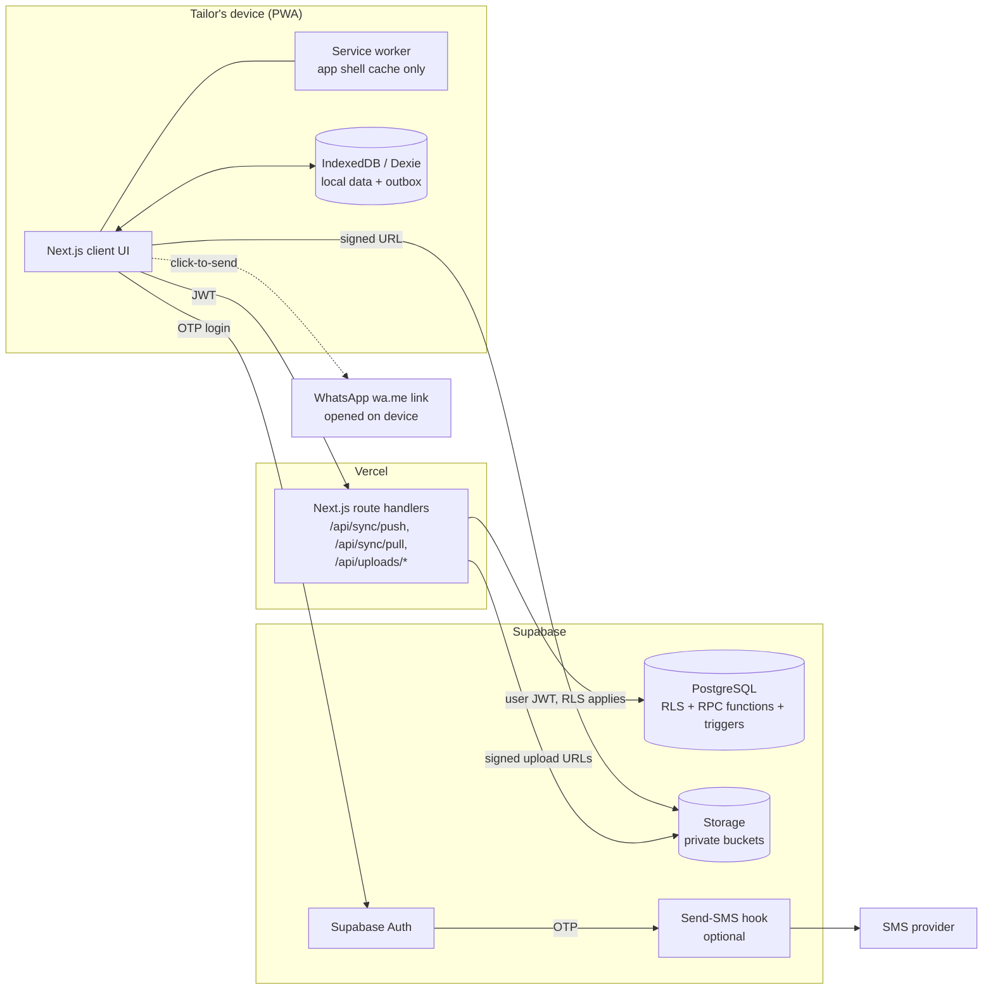

# TailorPro — ARCHITECTURE.md

**Status:** Phase 0 DRAFT for review. No implementation has started.
**Controlling spec:** `PRD.md` v1.0 plus the approved Phase 0 decisions (A–R, referenced below as "Decision X").
**Companion documents:** `DATABASE_SCHEMA.md`, `SECURITY.md`, `SYNC_DESIGN.md`, `IMPLEMENTATION_TRACKER.md`, `PHASE0_REVIEW.md`, `ZERO_BUDGET_REVIEW.md`.

> **REVISION 2 (zero-budget constraint, pending approval).** `ZERO_BUDGET_REVIEW.md` **supersedes** the hosting choice (Vercel Pro), the cost table in §8 and the phone-OTP assumption in this file. Vercel Hobby is not usable for a commercial pilot (Vercel terms §4: personal or non-commercial use only). Proposed instead: Supabase Free + Cloudflare static hosting and a thin Worker, with the authenticated app as a Next.js **static export**. AD-1 (writes via server-side functions) and AD-2 (client-rendered shell) are kept; AD-2 becomes essential because no Next.js server exists. Sections below that mention Vercel, Pro plans, Next.js route handlers or SMS describe the *previous* paid plan and are retained only for comparison until you approve Revision 2.

---

## 1. Approved technology stack (Decision A)

| Layer | Choice | Notes |
|---|---|---|
| Frontend / server | Next.js (App Router) + TypeScript | See AD-2: the authenticated app is a client-rendered shell |
| Database | PostgreSQL via Supabase | Authoritative store; RLS enforces tenant isolation |
| Auth | Supabase Auth (phone OTP primary, email optional) | Decision D. No custom password or auth system |
| Object storage | Supabase Storage (private buckets) | Workspace-scoped policies |
| Offline | PWA + service worker + IndexedDB via Dexie.js | Decision A: Supabase does **not** provide offline sync |
| Sync | Custom engine (client outbox + server sync API) | Specified in `SYNC_DESIGN.md` |
| Hosting | Vercel (Pro, see §8) | Alternatives acceptable if you prefer |

**Candidate supporting libraries (minor decisions, to be confirmed in a Phase 1 spike, none are approved yet):**
Serwist (service worker / precache for Next.js), Zod (validation shared client/server), next-intl (i18n, Decision K), Vitest, Playwright, Supabase CLI with local Docker Postgres for migrations and RLS tests (pgTAP for DB-level tests), Sentry or equivalent for error logging.

---

## 2. System context



---

## 3. Key architectural decisions

### AD-1 Writes go through server-side functions, not direct table writes
> **Refinement approved 2026-11-17:** the write functions are `SECURITY DEFINER` (empty `search_path`) and perform their own authorization, because an invoker function cannot work without direct write grants. See `SECURITY.md` section 11.2. The text below that says `SECURITY INVOKER` is superseded.

All tenant-data mutations are executed by Postgres functions (`SECURITY INVOKER`, called with the **user's** JWT so RLS still applies), invoked from Next.js route handlers. The `authenticated` role gets `SELECT` (RLS-filtered) and `EXECUTE` on those functions, but **no direct INSERT/UPDATE/DELETE grants** on tenant tables.
- Business invariants (payment rules, status transitions, snapshot immutability, plan limits) live in functions, triggers and constraints, never only in the frontend (CLAUDE.md §5).
- Defense in depth: even if a function has a bug, RLS still restricts to the member's workspace.
- The Supabase `service_role` key is used only by server-side jobs that need it (backups, admin aggregates, scheduled reminder generation). It never ships to the browser and is never used on a path that handles a user-supplied workspace ID without an explicit membership check. Every use is listed in `SECURITY.md`.
- **Why flagged:** it limits how the client may use Supabase (no direct PostgREST writes). It is an implementation choice inside the approved stack, not a PRD change.

### AD-2 Client-rendered authenticated app shell
Offline-first means pages must render with no network. Next.js server components that fetch data at request time cannot do that. Therefore:
- Public pages (landing, login) may be server-rendered.
- The authenticated app (`/app/**`) is a precached shell. It reads **only from Dexie** and never from server-rendered data. Data reaches Dexie through the sync engine.
- The service worker caches the app shell and static assets. It never caches authenticated API responses or storage URLs.
- **Risk:** Next.js is less natural for this pattern than a plain SPA. Mitigation: a Phase 1 spike proves "install, go offline, cold-start, navigate" before any feature work. If it fails, I will present alternatives under change control.

### AD-3 Local-first data access from Phase 1
Although the offline engine is Phase 5 (PRD §14), from Phase 1 onward:
1. All primary keys are UUIDs generated client-side (UUIDv7 preferred for index locality; to be confirmed).
2. UI code reads and writes through a repository layer that can be backed by Dexie plus outbox.
3. Every mutating server operation is idempotent (takes an operation ID).

This is not a scope change. It prevents a rewrite in Phase 5.

### AD-4 Money
All amounts are `bigint` in minor currency units with an explicit `currency` code (Decision N). MWK is the only enabled currency; a `currencies` table holds the exponent so more can be added later. No floats.

### AD-5 Time
Timestamps are `timestamptz` (UTC). The promised collection date is a `date` interpreted in the business timezone (`businesses.timezone`, default `Africa/Blantyre`). Deadline categories are computed in that timezone, both in SQL and in the client, from the same shared function with shared test vectors. The server clock is authoritative for ordering. Device clocks are display-only.

### AD-6 i18n (Decision K)
All user-facing strings live in message catalogs (English at launch, Chichewa and French later). No literals in components. Dates, numbers and currency use `Intl` with locale-aware formatting. Measurement field labels come from template data, which can carry per-locale labels later.

### AD-7 Layering
```
UI components  →  hooks/view-models  →  domain services (pure TS: balance, status rules,
                                         deadlines, conflict rules, validation)
                                     →  repositories (Dexie)  ⇄  sync engine  ⇄  API routes → Postgres functions
```
Domain rules (balance math, status transitions, deadline categories) are pure TypeScript modules with unit tests. The same rules are re-enforced in Postgres. Tests assert client and server agree.

### AD-8 Reminders (Decision H)
In-app only. Dashboard indicators are computed from local data. `reminder_events` rows are generated server-side by a scheduled job (pg_cron or equivalent, to be confirmed) and are idempotent per `(workspace, entity, type, event_date)`. No SMS, WhatsApp automation or push.

### AD-9 Data export (Decision I)
Owner-initiated export job producing a ZIP (CSV and JSON of customers, measurements, orders, items, payments, adjustments, status history) delivered via a short-lived signed URL. Permanent deletion is **not built** until the retention policy is approved.

---

## 4. Proposed repository layout

```
/app                 Next.js routes (public + /app shell)
/src/domain          pure business rules (no I/O)
/src/data            Dexie schema, repositories, sync engine
/src/server          route-handler logic, Supabase clients, validation
/src/ui              design system and components
/src/i18n            message catalogs
/supabase/migrations SQL migrations (forward and documented rollback)
/supabase/tests      pgTAP / SQL RLS and constraint tests
/tests               unit, integration, e2e, offline, security
/docs                ERD exports, runbooks
```

---

## 5. Environments (PRD §13)

| Env | Supabase project | Vercel | Purpose |
|---|---|---|---|
| Local | Supabase CLI (Docker) | `next dev` | Development, migrations, RLS tests |
| Staging | Separate project | Preview or staging deployment | Pre-release, restore drills, load tests |
| Production | Separate project | Production | Live |

Separate credentials per environment. Secrets live only in Vercel and Supabase environment settings, never in the repo. CI (GitHub Actions or equivalent) runs lint, type-check, unit, DB/RLS and security tests on every PR, and applies migrations to staging only after tests pass.

---

## 6. Performance budgets (Decision O)

| Target | Budget | How it will be measured |
|---|---|---|
| Local customer/order search | < 300 ms | Instrumented test on a representative mid-range Android device, with a seeded dataset (e.g. 2,000 customers, 5,000 orders; size to be agreed) |
| Common UI interactions | < 100 ms where practical | Performance marks in the Playwright and device runs |
| API p95 | < 500 ms | Load test on staging with normal-load profile |
| Bundles / images | No unnecessary weight | Bundle-size budget in CI; client-side image compression before upload |

Results will be recorded in `TESTING.md` with device model, OS, browser, network profile and dataset size. Nothing is reported as met until measured. **Open item:** which physical Android device(s) will be used (see `PHASE0_REVIEW.md`, decision R-11).

---

## 7. Backup and recovery architecture (Decision J)

**Provisional targets:** daily backups, 30-day retention, RPO 24 h, RTO 8 h.

**Finding:** based on Supabase's pricing page (fetched 2026-11-16), the Pro plan retains **7** days of daily backups, the Team plan 14 days, and the Free plan has none. Point-in-time recovery is a paid add-on. **Platform backups alone cannot meet the 30-day retention target on any plan listed.**

**Proposed design (needs approval, R-7):**
1. Use Supabase daily backups as layer 1 (Pro plan minimum for production).
2. Add a scheduled, encrypted logical dump (`pg_dump`) to storage outside Supabase, with 30-day retention, run from CI or a scheduler. Cost is small (see §8).
3. Back up Storage objects (attachments, logos) separately. Database backups should not be assumed to contain the files; this must be verified in Phase 7.
4. Quarterly and pre-launch **restore drills** into a scratch project, with documented timings against the 8 h RTO.
5. No "backup OK" indicator in any UI or document until a restore has succeeded.

---

## 8. Hosting and cost estimate (Decision A)

Prices fetched from vendor pages on 2026-11-16 are marked ✔. Anything marked ~ is an estimate or an unverified third-party figure and must be confirmed before budgeting. Currency conversion to MWK is intentionally omitted (rate not verified).

| Item | Plan / assumption | Monthly cost (USD) | Basis |
|---|---|---|---|
| Supabase production | Pro: from $25/mo; 8 GB DB disk, 100 GB storage, 100k MAU, 7-day backups, no pausing | 25 | ✔ supabase.com/pricing |
| Supabase staging | Free tier: 500 MB DB, 1 GB storage, **pauses after 1 week of inactivity, no backups**. Acceptable for staging, not for production | 0 (or a second paid project, price not verified) | ✔ for free-tier terms |
| Supabase PITR (optional) | $100/mo per 7 days of retention. **Not required** to meet RPO 24 h | 0 (optional 100) | ✔ |
| Supabase Team (not needed) | $599/mo, 14-day backups. Still short of 30 days | n/a | ✔ |
| Vercel production | **Pro $20/seat/mo.** The Hobby plan is described in Vercel's docs as non-commercial personal use only, so a paid SaaS needs Pro | 20 (1 seat) | ✔ price (pricing page); ~ commercial restriction (from Vercel docs via search; confirm in Terms) |
| External backup storage | S3-compatible bucket, encrypted dumps, 30-day retention, pilot-sized data | < 5 | ~ |
| Domain | .com or similar | ~1–2 (amortised) | ~ |
| Error monitoring / uptime | Free tiers likely enough at pilot scale | 0 | ~ unverified |
| OTP SMS | See table below | 13–132 | see below |

**Baseline platform cost (no SMS):** about **$45–55/month** for one production environment. SMS is the main variable.

### OTP SMS cost scenarios
Assumes 4 OTP logins per user per month (long-lived sessions mean logins are infrequent) and one user per business. If sessions expire sooner, or users reinstall or lose phones, costs rise. Retries and failed deliveries typically add more.

| Provider rate | Source | 10 businesses (40 OTP) | 100 businesses (400 OTP) |
|---|---|---|---|
| Twilio: $0.3307 per segment to Malawi | ✔ twilio.com Malawi SMS pricing page | ≈ $13 | ≈ $132 |
| Regional/aggregator: roughly €0.06–0.11 per SMS | ~ third-party comparison pages, not provider-verified | ≈ €2.5–4.4 | ≈ €25–44 |
| Africa's Talking | No Malawi rate found. Must request a quote | unknown | unknown |

**Features requiring paid plans:** production database with backups and no auto-pause (Supabase Pro); commercial hosting (Vercel Pro); SMS (pay-per-message, in every case). Supabase's "Advanced MFA (Phone)" at $75/mo is a different feature (phone as a second factor) and is **not** needed for phone OTP login.

Pricing for the business (plan prices charged to tailors) is outside this document; PRD §8 says it must be validated with real tailors.

---

## 9. Known architectural risks

| # | Risk | Mitigation |
|---|---|---|
| A1 | Offline-first conflicts with Next.js server rendering | AD-2 plus Phase 1 spike |
| A2 | Supabase's direct client access path bypasses the API | AD-1: no write grants; RLS on every table; tests connect as the `authenticated` role |
| A3 | Vendor lock-in to Supabase Auth and RLS conventions | Business logic is in plain SQL and TypeScript; auth provider is isolated behind a small interface |
| A4 | 30-day backup target not met by platform | §7 |
| A5 | SMS cost and abuse (SMS pumping) | `SECURITY.md` §3 |
| A6 | PWA install and storage-eviction differences on iOS | Android Chrome is primary support target; iOS best-effort (decision R-12) |
| A7 | Long-term cost if one Supabase project per environment is paid | Free tier for staging; revisit before pilot |


---

## 9. As built in Phase 1 (supersedes the earlier paid-plan text where they differ)
- **Hosting:** Next.js 16 static export (`output: 'export'`, trailing slashes) served as static assets (Cloudflare in staging/production, a Node stand-in locally); no Next.js server and no route handlers (Z-1, AD-2). The authenticated app is a client-rendered shell.
- **Auth:** Google and emailed 6-digit code through Supabase Auth behind `AuthAdapter` (`src/auth`). No passwords, no SMS (Z-2).
- **Writes:** `SECURITY DEFINER` functions with their own authorization (approved 2026-11-17; `SECURITY.md` 11.2). The browser calls them through PostgREST RPC with the user's token; no gateway Worker yet (decision D3).
- **Offline:** generated service worker (`scripts/sw.template.js`) precaches the shell; Dexie stores the account cache (`src/data`); account loading is stale-while-revalidate; a new worker waits for the user (`src/pwa`). Customers, orders and the outbox arrive with their phases; the sync engine is Phase 5.
- **Layering in practice:** UI (`app`, `src/ui`) calls hooks and the auth provider; rules live in `src/domain` (Zod schemas, activity labels) and mirror database rules, verified by shared test vectors; data access is in `src/data` and `src/auth`.
- **Build pipeline:** `next build`, then `scripts/make-headers.mjs` (policy), then `scripts/make-sw.mjs` (worker with a content-hashed cache name).
- **Not built:** gateway Worker, customers and later tables, sync endpoints, storage, staff invitations, subscription limits, business-settings screen, web app manifest and install prompt.
