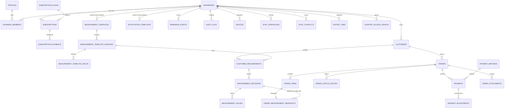

# TailorPro — DATABASE_SCHEMA.md

**Status:** Phase 0 DRAFT. Logical design only; no migrations exist yet.
**Source:** PRD §4, §6, Decisions B, C, E, N, plus CLAUDE.md §5.
Entities added beyond the PRD's "recommended initial entities" are marked **(+)** and justified. Additions are structural support for approved requirements, not scope expansion.

> **REVISION 2 (zero-budget, pending approval).** Proposed schema changes, all within the PRD, are listed in `ZERO_BUDGET_REVIEW.md` §8.2: (1) `private.current_user_id()` wrapper for portability; (2) `order_attachments.storage_provider` and `sha256`; (3) `export_jobs` deferred, export becomes an owner-only RPC assembled in the browser; (4) reminder generation via idempotent `generate_reminders()` RPC instead of a scheduled job; (5) `support_access_grants` deferred to Phase 6 (M7); (6) `sync_operations` pruned after about 90 days; (7) trigram index deferred; (8) `profiles.phone_e164` is a contact field, not an auth identity. **No essential integrity table or constraint is removed.** The tables below are unchanged until you approve; M7 will not include `export_jobs`, and the reminder job in the migration plan becomes an RPC.

---

## 1. Conventions

- **Workspace = `businesses.id`.** Every tenant-owned table has `workspace_id uuid NOT NULL REFERENCES businesses(id)`.
- **UUID primary keys**, generated by the client for offline-creatable records.
- **Composite uniqueness for tenant safety:** every tenant table has `UNIQUE (workspace_id, id)`. Child tables reference parents with **composite FKs** `(workspace_id, parent_id) → parent(workspace_id, id)`. A row can therefore never point at another tenant's parent, even if RLS were misconfigured.
- Standard columns: `created_at`, `updated_at` (timestamptz, server-set), `created_by`, `version int` (optimistic concurrency; incremented by trigger), `server_seq bigint` (change-feed cursor, see `SYNC_DESIGN.md`).
- **No hard deletes** of business records. `archived_at`, `archived_by` (+ reason where required). No DELETE grant or policy exists on tenant tables.
- **Money:** `bigint` minor units + `currency char(3)`; CHECKs for sign rules (Decision N, AD-4).
- Enum-like columns use Postgres enums or `CHECK` constraints; changes via migration only.
- All schema changes via versioned SQL migrations with a documented rollback note. No manual production changes.

---

## 2. Entity-relationship diagram



---

## 3. Tables

Columns shown are the significant ones; standard columns (§1) are implied.

### 3.1 Identity, tenancy, SaaS

| Table | Key columns and constraints |
|---|---|
| `profiles` ("users") | `id` = `auth.users.id`, `full_name`, `phone_e164` (nullable if email-only), `email` (optional), `locale` default `en`. Phone/email identity itself lives in Supabase Auth |
| `businesses` | `name`, `owner_name`, `phone`, `email` (optional), `location`, `country` (default `MW`), `currency` (default `MWK`), `business_type`, `timezone` (default `Africa/Blantyre`), `logo_path`, `status` (active/suspended), `archived_at` |
| `business_members` | `workspace_id`, `user_id`, `role` (owner/staff), `permissions jsonb`, `status`; `UNIQUE(workspace_id,user_id)`; exactly one active owner enforced by partial unique index. Multi-user supported in schema from day one (PRD §3.3) |
| `platform_admins` (+) | `user_id`; separate from `business_members`. Grants **no** policy on tenant tables (see `SECURITY.md` §5) |
| `support_access_grants` (+) | `workspace_id`, `admin_user_id`, `granted_by` (owner), `reason`, `scope`, `expires_at`, `revoked_at`. Required by PRD §3.1 "authorized, logged, limited" exceptional access |
| `subscription_plans` | `code`, `name`, `limits jsonb` (e.g. active_orders, customers, members, max_images_per_order), `price_minor_monthly/annual`, `currency`, `active` |
| `subscriptions` | `workspace_id`, `plan_id`, `status` (trialing/active/grace/expired/suspended), `billing_period` (monthly/annual), `current_period_start/end`, `grace_ends_at`. Expiry changes status only; **no cascade or job deletes data** |
| `subscription_payments` (+) | `subscription_id`, `amount_minor`, `reference`, `verified_by` (platform admin), `verified_at`. Needed for PRD §8.1 "manually verified subscription payments"; append-only |
| `platform_settings` (+) | key/value for configurable limits (image max bytes = 5 MB, max images per order = 5, grace-period default) per Decision M and PRD §8.1 |
| `currencies` (+) | `code`, `minor_unit_exponent`, `enabled` (only MWK enabled) per Decision N |

### 3.2 Customers and measurements (Decision E)

| Table | Key columns and constraints |
|---|---|
| `customers` | `full_name`, `phone_raw`, `phone_e164`, `email`, `address`, `notes`, `archived_at/by`. **Non-unique** index `(workspace_id, phone_e164)` used for duplicate warnings (PRD §4.3). Trigram index on `full_name` for search |
| `measurement_templates` | `workspace_id` **nullable** (`NULL` = system default). `garment_type`, `name`, `archived_at`. System rows are readable by any authenticated user and writable by no user (only migrations/service role) |
| `measurement_template_versions` (+) | `template_id`, `version_no`, `published_at`. A published version is **immutable** (trigger). Editing a template creates a new version. Implements "template changes must not silently alter historical measurements" |
| `measurement_template_fields` | `template_version_id`, `field_key`, `label`, `unit` (default `cm`), `required`, `display_order`, optional `min_value/max_value`. Immutable with its version |
| `customer_measurements` | A **measurement profile**: `customer_id`, `template_version_id`, `profile_name`, `archived_at`. A customer can have many |
| `measurement_revisions` (+) | `customer_measurement_id`, `revision_no`, `recorded_by`, `recorded_at`, `note`. **Insert-only.** "Updating" a measurement creates a new revision, so old measurements remain accessible (PRD §4.4 items 4, 5) |
| `measurement_values` | `revision_id`, `field_key`, `value numeric`, `unit` (explicit; never converted). Insert-only. Label and unit are copied so the record is self-describing |

### 3.3 Orders (Decisions B, C)

| Table | Key columns and constraints |
|---|---|
| `orders` | `customer_id` (composite FK), `order_number` (**nullable until server assigns**, see decision R-1), `UNIQUE(workspace_id, order_number)` where not null, `currency` (must equal business currency), `status` (enum of 8), `status_before_hold` (nullable, set when put on hold), `promised_date date`, `notes`, `collected_at`, `cancelled_at`, `cancel_reason`, `archived_at`. **Order-level status only** (Decision C) |
| `order_items` | `order_id`, `garment_type`, `description`, `quantity > 0`, `unit_price_minor >= 0`, `reference_attachment_id` optional. Order total = Σ(quantity × unit_price) (see decision R-14). `UNIQUE(workspace_id, id)` so item-level status can be attached later |
| `order_measurement_snapshots` | `order_id`, `order_item_id`, `source_revision_id` (nullable, informational only), `template_version_id`, `garment_type`, `values jsonb` = `[{key,label,unit,value}]` copied in full. **Immutable**: trigger rejects UPDATE and DELETE. Contains everything needed to show the measurements without joining live data. Items may each have a different snapshot (PRD §4.5) |
| `order_status_history` | `order_id`, `order_item_id` (**nullable; NULL = order-level**; reserved so item-level status can be added later without redesign, Decision C), `from_status`, `to_status`, `kind` (forward/backward/hold/resume/cancel/correction), `reason`, `changed_by`, `changed_at` (server time), `client_changed_at`. Insert-only |
| `order_attachments` | `order_id`, `storage_path` (`{workspace_id}/{order_id}/{uuid}.{ext}`), `mime_type` (jpeg/png/webp), `size_bytes <= configured max`, `kind` (reference/fabric/style/finished), `archived_at`. Trigger limits non-archived rows per order to the configured max (default 5) |
| `workspace_counters` (+) | `workspace_id`, `order_seq`. Server-side sequential order number allocation |

#### Status transition rules (Decision B), enforced in one SQL function and mirrored in `/src/domain`

| From | Allowed to | Requirements |
|---|---|---|
| Received → Cutting → Sewing → Finishing → Ready for collection → Collected | next status only | Normal forward flow. *Skipping forward is not approved; see R-13* |
| Any active production status (Received…Ready for collection) | any **earlier** active production status | **Reason required**; `kind = backward` |
| Any active status (Received…Ready for collection) | On hold | Stores `status_before_hold` |
| On hold | the stored `status_before_hold` | `kind = resume` |
| Any active status or On hold | Cancelled | **Reason required**; allowed only before Collected. Payments are retained |
| Collected | (nothing via normal actions) | Owner-only correction with **reason**, audited; `kind = correction` (target status: see R-13) |
| Any | Collected | From Ready for collection only. If balance > 0, **warn but do not block** (Decision B) |

- A deadline passing never changes status (PRD §4.6). No scheduled job writes to `orders.status`.
- Only authorized users may confirm Ready for collection (permission check in the function).
- Every change writes `order_status_history` and an `audit_logs` row in the same transaction.
- **Payment status is separate from collection status** (Decision B): it is derived (§3.4), not stored on `orders`.

### 3.4 Payments (PRD §4.9, CLAUDE.md §5)

| Table | Key columns and constraints |
|---|---|
| `payment_methods` (+) | `workspace_id` nullable (system defaults: cash, bank_transfer, mobile_money), `code`, `label`, `active`. Supports "other configurable payment methods" |
| `payments` | `order_id`, `amount_minor > 0` (CHECK), `currency`, `method_id`, `transaction_date`, `reference`, `notes`, `recorded_by`, `idempotency_key` with `UNIQUE(workspace_id, idempotency_key)`. **Insert-only**: no UPDATE/DELETE policies and a trigger that raises on both. Composite FK `(order_id, currency) → orders(id, currency)` guarantees currency match |
| `payment_adjustments` | `payment_id`, `order_id`, `type` (reversal/refund), `amount_minor > 0`, `reason NOT NULL`, `created_by`, `idempotency_key`. Insert-only. Trigger: Σ adjustments per payment ≤ payment amount. A "correction" is modelled as a reversal plus a new linked payment (minor design choice) |

**Derived financials (view/function `order_financials`, one definition used everywhere):**

```
order_total      = Σ(order_items.quantity × unit_price_minor)
total_paid       = Σ(payments.amount) − Σ(payment_adjustments.amount)
balance          = order_total − total_paid
payment_status   = unpaid | partial | paid | overpaid        (overpaid only if R-2 approved)
```
- The balance is never stored as an editable number.
- Overpayment on the online path is rejected inside the payment function under a row lock on the order (`SELECT … FOR UPDATE`), because a CHECK constraint cannot see other rows. Offline overpayments: see R-2.
- Cancelled orders keep all payments; new payments on a cancelled order are rejected except refund adjustments (confirm in R-14).

### 3.5 Operations, audit, sync

| Table | Key columns |
|---|---|
| `notification_templates` | `workspace_id` nullable (system), `code` (6 templates of PRD §4.10), `locale`, `body` with placeholders. Rendering uses live data; opening WhatsApp records nothing as "delivered" |
| `reminder_events` | `type` (due_today / due_soon / overdue / ready_uncollected / subscription_expiring / subscription_expired), `order_id` nullable, `subscription_id` nullable, `event_date`, `acknowledged_at`; `UNIQUE(workspace_id, type, order_id, event_date)` so generation is idempotent |
| `audit_logs` | `actor_id`, `workspace_id` nullable, `action`, `entity`, `entity_id`, `diff jsonb` (**redacted**: no measurement values, no tokens), `created_at`. Insert-only; readable by owner for own workspace |
| `devices` (+) | `workspace_id`, `user_id`, `label`, `last_seen_at` |
| `sync_operations` (+) | `PRIMARY KEY(workspace_id, op_id)`, `device_id`, `entity`, `entity_id`, `op_type`, `status` (applied/rejected/conflict), `result jsonb`, `applied_at`. Idempotency ledger |
| `sync_conflicts` (+) | `entity`, `entity_id`, `op_id`, `client_payload`, `server_state`, `status` (open/resolved), `resolution`, `resolved_by` |
| `export_jobs` (+) | `requested_by`, `status`, `storage_path`, `expires_at` (Decision I) |

---

## 4. Dashboard metric definitions (PRD §4.8)

All computed from live records with the same functions on server and client.

| Metric | Definition |
|---|---|
| Total active customers | **Open decision R-5.** Default proposal: customers with `archived_at IS NULL` |
| Orders received today | `created_at` falls on today in the business timezone, excluding cancelled |
| Active orders | status in Received…Ready for collection, or On hold |
| Due today / tomorrow / within 7 days / upcoming / overdue | `promised_date` vs business-timezone today, for active (not Collected/Cancelled) orders. Overdue = `promised_date < today` |
| Ready for collection | status = Ready for collection |
| Outstanding balances | Σ positive `balance` over non-cancelled orders (cancelled treatment: R-14) |
| Recent activity | latest `audit_logs`/status history/payments for the workspace |

---

## 5. Indexes (initial)

`(workspace_id, …)` leading on every tenant table; `customers(workspace_id, phone_e164)`; trigram on `customers.full_name`; `orders(workspace_id, status, promised_date)`; `orders(workspace_id, customer_id)`; `payments(workspace_id, order_id)`; `order_status_history(workspace_id, order_id, changed_at)`; `server_seq` per table for the change feed; `reminder_events(workspace_id, event_date)`. Final set is tuned with `EXPLAIN` on seeded data in Phases 3–4.

---

## 6. Migration plan (each independently testable)

| Migration group | Phase |
|---|---|
| M1 extensions, helper schema, `profiles`, `businesses`, `business_members`, RLS helper functions, `audit_logs` | 1 |
| M2 plans/subscriptions skeleton, `platform_settings`, `currencies` | 1 |
| M3 customers, templates (+ system seeds), versions, profiles, revisions, values | 2 |
| M4 orders, items, snapshots, status history, attachments, counters, transition function | 3 |
| M5 payments, adjustments, methods, `order_financials`, constraints | 4 |
| M6 devices, `sync_operations`, `sync_conflicts`, `server_seq` and feed | 5 |
| M7 limits enforcement, support access, export jobs, reminder generation | 6 |

Each migration ships with: tests, a rollback note (expand/contract pattern; destructive rollbacks are never run on production data without a verified backup), and an update to this document.

---

## 7. Database-level tests planned

- Cross-tenant SELECT/INSERT/UPDATE/DELETE attempts as `authenticated` on **every** tenant table.
- Composite-FK rejection of cross-tenant parent references.
- Snapshot, revision, payment and history immutability triggers.
- Status transition matrix (all allowed and disallowed pairs).
- Balance invariants including adjustments, concurrent payment race (two simultaneous payments near the balance), currency mismatch, zero/negative amounts.
- Idempotency: replaying the same operation twice yields one row.
- Image-count and size limit triggers.
- Subscription expiry changes status but deletes nothing.
