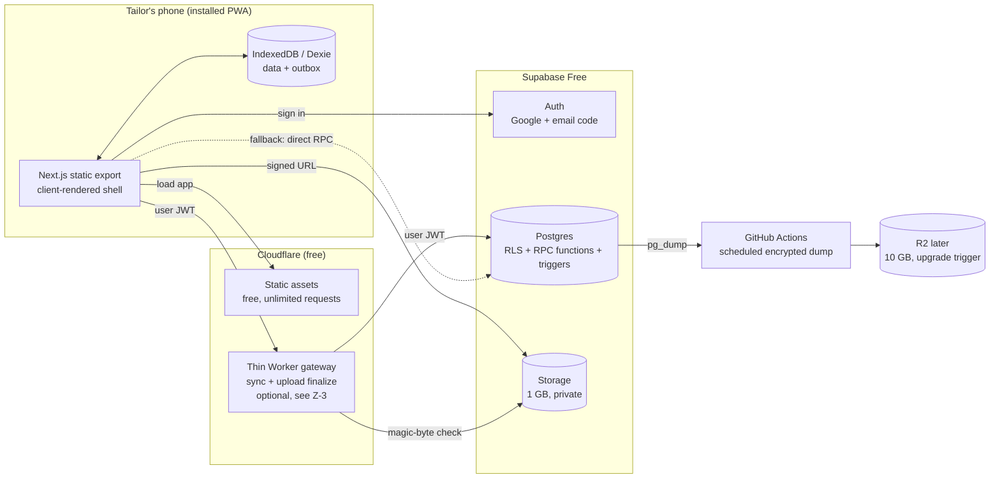

# TailorPro — ZERO_BUDGET_REVIEW.md (Phase 0, Revision 2)

**Status:** **Z-1, Z-2 and Z-4 APPROVED by the product owner.** Z-3 and Z-5 to Z-9 remain open (Z-3 is resolved by a Phase 1 spike). Phase 1 has not started. `PRD.md` is unchanged.

**What the approvals mean**
- **Z-1:** Supabase Free + Cloudflare static hosting, with Next.js static export. Vercel Hobby is excluded.
- **Z-2:** Google sign-in primary, optional email code, phone as a contact field only. This formally amends Decision D. Phone OTP is deferred as a funded upgrade. The approval is conditional on asking pilot tailors about Google/email access early; if that fails, I bring options back before building more on it.
- **Z-4:** the requirement to obtain **written confirmation that Supabase Free and Cloudflare Free permit a small commercial pilot** is approved as a gate. **The confirmation itself does not yet exist**, and I cannot obtain it. Until it is on file (tracker ZB-2), the system may be built and tested with test data only, and **no real business or customer data may be loaded**.
**Purpose:** Re-plan infrastructure for a **$0 development and pilot budget**. This document **supersedes** the paid-plan assumptions in `ARCHITECTURE.md` §1, §2 and §8, `SECURITY.md` §3 (authentication), and register items R-7, R-8 and R-16 in `PHASE0_REVIEW.md`. Those documents carry a pointer to this one.

**Evidence labels used throughout**
- ✔ **Verified**: read on the vendor's own page on 2026-11-16.
- ◐ **Partly verified**: vendor page was silent or contradictory, or only a secondary source was found.
- ○ **Assumption**: my estimate or general knowledge, not checked. Do not budget or promise anything from these.

Free-tier limits change without notice (Supabase's own email page says so about its limits). Re-verify before the pilot starts.

---

## 1. Bottom line

1. **A $0 pilot is achievable**, but only by accepting specific, documented trade-offs: no automatic backups, a project that can pause after a week of low activity, a 1 GB image store, and a free-tier-only email path.
2. **Recommended stack: Supabase Free (Postgres + Auth + Storage) + Cloudflare (static hosting, a thin Worker, later R2 for images).** Not Vercel Hobby: its terms restrict it to personal or non-commercial use.
3. **Authentication changes.** Phone OTP has no verified free path. I recommend **Google sign-in as the zero-cost primary, with email one-time codes as an optional second path**, and phone OTP deferred until there is revenue. This is a change to Decision D and needs your approval.
4. **Two terms questions I could not resolve from vendor pages** (commercial use on Supabase Free and on Neon Free). They need your written confirmation or a check with the vendors before real businesses depend on the pilot (decision Z-4).
5. **No essential requirement is removed.** Tenant isolation, measurement history, snapshots, append-only payments, offline persistence, sync safety and audit trails all stay. Only infrastructure and a few deferrable tables change (§8).

---

## 2. Free-tier limits and restrictions

### 2.1 Supabase Free
| Item | Limit | Status |
|---|---|---|
| Database size | 500 MB per project | ✔ |
| File storage | 1 GB; global per-file cap cannot exceed 50 MB; per-bucket limit can be set lower | ✔ |
| Monthly active users | 50,000 | ✔ |
| Egress | 5 GB | ✔ |
| Edge Function invocations | 500,000 | ✔ |
| Free projects | 2 across organisations where you are owner/admin (paused projects do not count) | ✔ |
| Pausing | Paused after about a week without sufficient database activity | ✔ (pricing page; docs wording "about a week of low activity") |
| Restore window for a paused project | **Conflicting official sources: 90 days vs 1 year.** Dashboard is authoritative | ◐ |
| Automatic backups | **None on Free.** Docs recommend regular `db dump` exports and off-site copies | ✔ |
| Do DB backups include Storage files? | **No**; only metadata. Files need separate backup | ✔ |
| Built-in email for Auth | Sends only to addresses on your organisation's team; **2 messages per hour**; no SLA; "not for production". A custom SMTP provider is required (then default 30/hour, adjustable) | ✔ |
| Phone OTP | Needs a third-party SMS provider (paid per message). No free provider found | ✔ (providers) / ◐ (no free option exists) |
| Google OAuth sign-in | Supported; needs a Google Cloud OAuth client. Basic scopes (openid, email, profile) are the defaults; sensitive scopes may trigger verification. Plan availability not stated on the page | ✔ setup / ◐ plan availability |
| **Commercial / production use on Free** | **Not addressed on the pages I read.** Terms excerpt limits use to "Customer's internal business purposes" (general, not Free-specific) | ◐ **unresolved** |

### 2.2 Neon Free
| Item | Limit | Status |
|---|---|---|
| Storage | 1 GB per project, 20 GB per account | ✔ |
| Compute | 100 CU-hours per project (per month, ○ period); up to 2 CU (8 GB RAM) | ✔ numbers / ○ period |
| Autosuspend | After 5 minutes; cannot be turned off | ✔ |
| Projects / branches | 100 projects, 10 branches per project | ✔ |
| Point-in-time history | 6 hours (1 GB limit): a safety net, **not** a backup | ✔ |
| Pooled connections | Up to 10,000 per compute | ✔ |
| Egress | 5 GB per project | ✔ |
| Auth | "Neon Auth" = managed Better Auth in your database; OAuth providers mentioned; **phone OTP not mentioned; free-plan availability and limits not stated** | ◐ |
| RLS | Data API validates JWTs and offers `auth.user_id()` for policies | ✔ |
| File storage | **None** | ✔ (absence on pages read) |
| Commercial use on Free | Not stated on pages read | ◐ **unresolved** |

### 2.3 Cloudflare
| Item | Limit | Status |
|---|---|---|
| Static asset requests (Workers/Pages assets) | "Free and unlimited"; not counted against request limit | ✔ |
| Workers (Free) | 100,000 requests/day; **10 ms CPU per invocation**; 50 subrequests per invocation; 128 MB memory; 64 MiB script | ✔ |
| Pages (Free) | 500 builds/month; 20,000 files; Pages Functions share the Workers Free quota | ✔ |
| KV (Free) | 100k reads/day, 1k writes/day, 1 GB | ✔ |
| D1 (Free) | 5M rows read/day, 100k written/day, 5 GB | ✔ (not planned for use) |
| Hyperdrive (Free) | 100,000 queries/day | ✔ (not planned for use) |
| R2 (Free) | 10 GB-month Standard storage, 1M Class A ops, 10M Class B ops, **egress free** | ✔ |
| R2 account activation may require a payment method on file | Not checked | ○ **verify before relying** |
| Commercial use on Free | Self-Serve Subscription Agreement text read: **no non-commercial restriction**; only bars collecting card data on free-service sites (not our case). Service-specific terms not read | ✔ agreement / ◐ service terms |
| Turnstile (CAPTCHA) free | Page did not state pricing | ○ |

### 2.4 Vercel Hobby
| Item | Limit | Status |
|---|---|---|
| Included usage | 100 GB transfer, 1M function invocations, 4 CPU-hours, function max 300 s, 100 deployments/day | ✔ |
| **Use restriction** | Terms §4: *"You shall only use the Services under a Hobby plan for your personal or non-commercial use."* "Commercial" is not defined in the text I read | ✔ |
| Conclusion | **Not suitable for a pilot with paying or business users.** Paid Pro ($20/seat) is the only compliant option on Vercel. Do not use Hobby for TailorPro's pilot without written clarification from Vercel | ✔ |

### 2.5 Email delivery (only if email codes are used)
| Provider | Free limit | Status |
|---|---|---|
| Resend | 100/day, 3,000/month, up to 3 domains; **needs a domain you own** to send to arbitrary recipients | ✔ limits / ○ domain requirement |
| Brevo | 300/day; sender-address verification may work without a domain; one account cap shared with marketing sends | ◐ (secondary sources, "check Brevo's help centre") |

### 2.6 Other free items assumed
GitHub Actions free minutes for private repos (for CI and backup jobs), Sentry or similar free error logging, free uptime monitor, `*.pages.dev` / `*.workers.dev` hostnames. All ○ **assumptions**, to be verified before Phase 7.

---

## 3. Neon vs Supabase for TailorPro

The comparison is about the **complete backend**, not database price. TailorPro needs auth, tenant-isolated rows, tenant-isolated private files, transactional business rules, and a backup path.

| Criterion | Supabase Free | Neon Free (+ Cloudflare R2 + a separate auth) |
|---|---|---|
| PostgreSQL compatibility | Real Postgres, RLS, triggers, functions, extensions ○ | Real Postgres, RLS, triggers, functions ○ |
| DB storage | 500 MB ✔ | 1 GB ✔ |
| Compute | Shared, limits not published on pages read ◐ | 100 CU-hours; auto-suspends after 5 min ✔; cold start after idle (duration ○ not measured) |
| Connection pooling | Pooler exists ○ | Up to 10,000 pooled connections ✔ |
| Authentication | **Built in**, 50k MAU, email/OAuth, phone via paid SMS ✔ | Managed Better Auth (OAuth; phone OTP not mentioned; free limits not stated) ◐ **or** build/bring your own (violates "don't build custom auth") |
| RLS and tenant isolation | `auth.uid()` in policies; **auth, RLS and storage policies in one system** ✔ | RLS with JWT via Data API `auth.user_id()` ✔; separate auth provider must be wired to it (unverified for external JWKS) ◐ |
| File storage | 1 GB, private buckets with RLS policies ✔ | None; use R2 (10 GB, egress free ✔) but **access control must be custom** (Worker signs URLs after a membership check) |
| Offline sync compatibility | Neither provides sync; both host the custom engine equally. Neon's 5-min autosuspend adds cold-start latency to the first sync after idle ◐ | Same |
| Backups | None automatic; self-managed `pg_dump`; Storage separate ✔ | 6-hour history only ✔; self-managed `pg_dump` still needed; R2 objects separate |
| Inactivity | **Pauses after ~1 week of low activity** ✔; restorable (90 days or 1 year) ◐ | Compute suspends after 5 min but **resumes on connection**; no project pause stated ◐ |
| Commercial-use terms | Unresolved ◐ | Unresolved ◐ |
| Free project count | 2 ✔ | 100 ✔ |
| Moving to paid | Same project upgrades to Pro ($25, ✔) with no migration | Same |
| Switching between the two later | Moderate: replace PostgREST RPC calls, auth, storage policies | Moderate |
| Engineering effort and security surface | **Lowest**: fewest custom parts holding tenant data | **Higher**: custom API, auth wiring, signed-URL service, more places a tenant-isolation bug can hide |

**Recommendation: Supabase Free for the pilot.** Neon's advantages (twice the DB space, no whole-project pause, 100 projects) are real, but TailorPro's hardest requirements are tenant isolation and file isolation, and Supabase gives those in one coherent system with less custom code. Less custom code means fewer security defects, which matters more than 500 MB vs 1 GB.

**Neon stays documented as the fallback** if (a) the weekly-pause rule proves unworkable, (b) the 500 MB limit is reached before revenue, or (c) Supabase's commercial terms for Free prove unacceptable. Keeping the app portable (§5) makes that move bounded.

---

## 4. Recommended zero-cost architecture

### Layers and choices
| Layer | Choice | Cost | Why |
|---|---|---|---|
| App hosting | Next.js **static export** on Cloudflare Pages/Workers assets | $0 ✔ | Authenticated app is already a client-rendered shell (AD-2); static requests are free and unlimited |
| Server compute | **None required for most paths.** Writes and sync are Postgres RPC functions called with the user's JWT. A thin Cloudflare Worker (Hono) adds batch-size caps, rate limiting, and the image-finalize step | $0 within 100k req/day ✔ | Keeps business rules in Postgres (portable) and avoids a paid server |
| Database, Auth | Supabase Free | $0 ✔ | See §3 |
| Images | Supabase Storage 1 GB at first, behind a `StorageAdapter`; move to R2 at the upgrade trigger | $0 ✔ | Defers the signed-URL service until needed |
| Backups | GitHub Actions scheduled `pg_dump` + Storage export, encrypted, to R2 (if free activation works) or another free destination | $0 ◐ | Free Supabase has no backups ✔ |
| Email (optional) | Brevo or Resend free SMTP | $0 ◐ | Only if email codes are enabled |
| CI | GitHub Actions | $0 ○ | |
| Hostnames | `*.pages.dev` / `*.workers.dev` | $0 ○ | Domain is optional (Z-9) |

### Impact on earlier architecture decisions
- **AD-1 (writes via functions) is kept.** The difference: functions are invoked from the browser (via the thin gateway or direct RPC) instead of Next.js route handlers.
- **AD-2 (client-rendered authenticated shell) becomes essential**, since no Next.js server exists. Consequence: Next.js is used as a static-export framework only. A simpler Vite + React setup would do the same job; I recommend **keeping Next.js as approved** (portable to Vercel or Node SSR later) but flag the option (Z-8).
- **Rate limiting (PRD §7):** edge rate limiting is weaker without a server. The gateway adds per-user and per-IP limits using free Cloudflare features (limits ○ unverified), plus DB-side batch-size caps and plan limits. If the gateway's 10 ms CPU budget cannot carry JWT checks plus forwarding, the fallback is direct RPC with database-level limits only. **A Phase 1 spike measures this** (Z-3).

---

## 5. Portability (no rewrite when paying later)

| Concern | Rule |
|---|---|
| Business logic | Plain SQL (functions, triggers, constraints) and pure TypeScript domain modules. No vendor-specific logic inside |
| Supabase coupling | Confined to four seams: `private.current_user_id()` (wraps `auth.uid()`), RPC transport, an `AuthAdapter`, and a `StorageAdapter`. Everything else is standard Postgres |
| Migrations | Plain SQL files runnable on any Postgres |
| Frontend | Static export now. Deployable to Vercel/Node/any CDN later |
| Gateway | Hono code runs on Workers, Node or Vercel unchanged |
| Images | `order_attachments.storage_provider` column plus checksum, so objects can move provider by provider |
| Auth identities | Keyed by an opaque user UUID, not by phone or email |

**Realistic move costs:** Supabase Free → Supabase Pro: none (same project). Supabase → Neon: moderate. Cloudflare → Vercel: low.

---

## 6. Authentication at zero cost

### 6.1 Options
| Option | Cost | Security | Fit for Malawian tailors | Notes |
|---|---|---|---|---|
| **Google sign-in (OAuth)** | $0 ✔ (Supabase supports; Google Cloud OAuth client free ○) | Strong: Google handles passwords, MFA, recovery | Most Android users have a Google account ○ (to validate in the pilot) | No password to build or leak; needs Google Cloud console setup; brand verification optional ✔ |
| **Email one-time code** (or magic link) | $0 within free SMTP limits ◐ | Good | Needs an email address and working email on the phone | Built-in Supabase email is unusable (2/hr, team-only ✔). Needs custom SMTP. Codes work better than links inside an installed PWA ○ |
| Email + password | $0 within SMTP limits | Weaker (reuse, forgetting); reset needs email anyway | Poor: password resets by email for users who struggle with email | Not recommended |
| **Phone OTP** | **Paid per SMS** ✔ ($0.3307 per message on Twilio to Malawi ✔; cheaper unverified) | Moderate (SIM-swap risk) | Best fit for the audience | **Excluded until you approve a cost.** Architecture keeps it switchable |
| WhatsApp OTP | Twilio only in Supabase ✔; paid | | | Excluded |
| Phone + PIN (custom) | $0 | Weak; violates "no custom auth" | | Rejected |
| Passkeys / WebAuthn | Unknown | Strong | Unclear on low-end Android | Not verified for Supabase; revisit after MVP |

### 6.2 Recommendation (change request to Decision D)
1. **Google sign-in is the primary login.** Email one-time codes are an optional second path once a free SMTP route is verified (Brevo single-sender or Resend with a domain).
2. **Phone number becomes a required business/profile contact field, not a login identity.** This does not weaken PRD §4.1 ("email or supported phone-based identity").
3. **Phone OTP becomes a funded upgrade**, triggered as described in §9 (SMS cost vs revenue). Because identities are keyed by opaque user ID, enabling it later requires no schema change.
4. Sessions use long-lived refresh tokens (Supabase default behaviour ○) so logins stay infrequent.
5. **Honest limitation:** if many pilot tailors lack a Google account or reliable email, this path fails the audience. Validate in the first pilot conversations before building around it (Z-2).
6. Recovery: Google's own recovery for Google logins; email code for email logins; manual support recovery for fully locked-out accounts (R-9 unchanged). Phone-change procedures are not needed while phone is not an identity.

CAPTCHA/SMS-pumping controls (`SECURITY.md` §3.3) are unnecessary while there is no SMS; email-code abuse is bounded by SMTP limits and Supabase auth rate limits.

---

## 7. Costs

### 7.1 Monthly cost, development and pilot
| Item | Cost |
|---|---|
| Supabase Free (production + staging projects) | $0 ✔ |
| Cloudflare static hosting + Worker + R2 free tier | $0 ✔ (R2 activation caveat ○) |
| Google sign-in | $0 ○ |
| SMTP free tier (if used) | $0 ◐ |
| GitHub Actions / CI / monitoring free tiers | $0 ○ |
| SMS | $0 (not used) |
| **Total infrastructure** | **$0 target ✔ achievable if the assumptions hold** |

### 7.2 Unavoidable or likely costs, and alternatives
| Item | When | Alternative |
|---|---|---|
| Real Android test device (R-11) | Phase 5, needed for the offline acceptance tests | Borrow a pilot tailor's phone for supervised tests |
| Custom domain (~$10–15/yr ○) | Optional; recommended by Supabase for auth trust | Use `*.pages.dev` |
| Legal review of Malawi data protection (LEG-1) | Before pilot with real customer data | Not an infrastructure cost, but it is a real one. Pilot with a documented limited-data agreement is a decision for you and counsel |
| Supabase Pro ($25 ✔) | Upgrade triggers, §9 | Neon fallback is also free but costs engineering time |
| Phone OTP SMS | Only if approved | Stay on Google/email |
| Your time for backups and monitoring | From day one | Automated scripts reduce, not remove |

---

## 8. Database and schema review (what can be deferred)

### 8.1 Not negotiable, unchanged
`workspace_id` everywhere, composite FKs, RLS (ENABLE + FORCE), insert-only payments / adjustments / revisions / snapshots / status history / audit logs, immutable template versions and snapshots, derived balances, idempotency keys, sync ledger, server-validated status transitions, no hard deletes.

### 8.2 Changes (all within the PRD)
| # | Change | Reason | Effect |
|---|---|---|---|
| 1 | Add `private.current_user_id()` wrapper used by all policies and functions | Portability seam (§5) | None functionally |
| 2 | `order_attachments`: add `storage_provider`, `sha256`; path convention stays `{workspace_id}/{order_id}/{uuid}.ext` | Move images Supabase → R2 later | Small |
| 3 | **Defer** `export_jobs`. Export becomes an owner-only RPC returning JSON that the browser assembles into a ZIP of CSV/JSON; the export is audit-logged | Avoids Storage use, jobs and server compute. EXP-1 still satisfied | Table removed from Phases 1–6 |
| 4 | **Replace the scheduled reminder job** with an idempotent `generate_reminders(workspace)` RPC run on app open and after sync. Unique key `(workspace_id, type, order_id, event_date)` remains | Avoids relying on `pg_cron` availability on Free (○ unverified). Indicators are computed locally offline anyway | Behaviour same for the user |
| 5 | **Defer** `support_access_grants` to Phase 6; until then no support-access path exists (stricter than the PRD requires) | No benefit before a support process exists | Table moves to M7 |
| 6 | `sync_operations`: add retention (prune after about 90 days). Safe because creates are protected by unique entity IDs and payments by the unique idempotency key on `payments` itself | DB size | Small |
| 7 | **Defer** trigram index on `customers.full_name`; use `lower(full_name)` btree prefix plus phone index. Offline search runs on Dexie regardless | Index size; extension availability ○ | Revisit if server search is slow |
| 8 | `profiles.phone_e164` remains a contact field; no auth dependency on it | Z-2 | None |
| 9 | Free-tier defaults in `platform_settings`: image compression target and per-order limits are configurable (Decision M's 5 MB / 5 images stay as the ceiling) | Storage budget (§10) | Config only |

No other table is removed. Subscription tables stay (PRD §8 foundation) but UI and limit enforcement remain Phase 6.

---

## 9. Upgrade triggers and migration strategy

Triggers are deliberately conservative. Hitting any one is a *decision point*, not an automatic spend.

| Trigger | Threshold (proposal) | Action |
|---|---|---|
| A business relies on the app for live operations and data loss would be unacceptable | Before the first paying customer, or earlier at your discretion | **Supabase Pro ($25 ✔):** daily backups (7-day ✔), no pausing. Keep the external 30-day dumps |
| Project paused or at risk of pausing | Any pause event | Restore; evaluate Pro; do not rely on artificial keep-alive (Z-5) |
| DB size | 400 MB (80%) | Prune `sync_operations`; evaluate Pro (8 GB ✔) or Neon |
| Storage | 700 MB (70%) | Move images to R2 via `StorageAdapter` |
| Cloudflare Worker requests / CPU | 70,000 per day, or CPU-limit errors observed | Slim gateway, or move to Workers paid or Vercel |
| Email codes | 70 per day | Brevo/Resend paid tier or reconsider auth |
| Phone OTP demand | Revenue per business supports SMS cost (OTP cost × expected logins is under an agreed % of that business's subscription) | Approve provider; enable phone OTP |
| Commercial-terms issue | Vendor says Free is not allowed for the use | Move to paid tier or Neon + Cloudflare |

**Migration playbook (documented now, rehearsed before pilot):** Supabase Free → Pro is an in-place plan change. For Supabase → Neon: dump schema and data (`pg_dump`), restore on Neon, replace the RPC transport with the gateway or Neon Data API, replace `AuthAdapter` and `StorageAdapter`, re-run the whole security and tenant-isolation suite. The test suite is the migration safety net.

---

## 10. Capacity estimates (all ○ assumptions to validate in the pilot)

| Item | Assumption | Result |
|---|---|---|
| Rows per business-year | 300 customers, 1,000 orders (about 2 items each), 1,500 payments, 500 measurement revisions, 5,000 audit rows | |
| Size per business-year (with indexes) | Roughly 10–20 MB | 10 pilot businesses ≈ 100–200 MB per year |
| 500 MB DB limit | After Supabase system schemas (○ not measured) | Supports the 10-business pilot for well over a year; a measured baseline is needed |
| Images | 30% of orders, 1.5 images, ~300 KB each after compression ≈ 135 MB per business-year | **10 businesses ≈ 1.35 GB per year: Storage (1 GB) is the first limit, within roughly 9 months** |
| Uncompressed 5 MB images | | Would exhaust 1 GB almost immediately |
| API volume | 20–100 sync calls per business per day | Far below 100k/day |

**Consequences:** compress images aggressively on the device (target about 1280 px, around 150–300 KB), keep Decision M's 5 MB / 5 images as ceilings, and plan the R2 move as the first upgrade. Measure real sizes in Phase 3.

---

## 11. Updated risk register (zero-budget additions)

| # | Risk | Severity | Mitigation | Evidence |
|---|---|---|---|---|
| Z1 | Free project pauses after ~1 week of low activity; app cannot sync | High | Real daily use by pilot businesses; offline app keeps working; pause alert; documented restore (window disputed between sources); upgrade trigger | ✔ pause rule |
| Z2 | No automatic backups; data loss from a mistake or platform incident | **High** | Scheduled `pg_dump` + Storage export to a second provider; **a restore drill before any real customer data** (PRD §13) | ✔ |
| Z3 | Storage 1 GB exhausted by images | Med | Compression, per-order limits, R2 move at 70% | estimate ○ |
| Z4 | Free-plan **commercial-use terms unclear** (Supabase, Neon) | **High until resolved** | You or counsel confirm with the vendor in writing; Neon/Cloudflare fallback | ◐ |
| Z5 | Worker 10 ms CPU limit too small for the gateway | Med | Keep gateway thin; Phase 1 measurement; fallback direct RPC with DB limits | ✔ limit |
| Z6 | Weaker rate limiting than a full server | Med | Gateway limits, batch caps, plan limits, Supabase auth limits | ◐ |
| Z7 | Google-only login excludes tailors without Google/email | **High for adoption** | Validate before building; email code as second path; funded phone OTP trigger | ○ |
| Z8 | Free SMTP limits or deliverability (email codes) | Med | Google as primary; verify Brevo/Resend; monitor | ✔ limits / ◐ |
| Z9 | Vendor changes or removes free limits | Med | Portability seams (§5); trigger table (§9) | ✔ (Supabase says limits can change) |
| Z10 | Dependence on one vendor for auth, DB and storage | Med | Adapters; Neon fallback documented | |
| Z11 | R2 may require a payment method on file | Low | Alternative backup destination chosen at Phase 7 | ○ |
| Z12 | Cold start after Neon autosuspend (only if Neon is chosen) | Low | Offline-first tolerates it | ◐ |
| Z13 | Free-tier operational limits on logs and monitoring | Low–Med | Own structured logging; verify retention | ○ |
| Z14 | Real customer data on a free tier without an SLA | **High** | Honest pilot terms ("best effort, backed up daily, no uptime guarantee"), Z-5 | |

The earlier risk registers (`ARCHITECTURE.md` §9, `SECURITY.md` §1, `SYNC_DESIGN.md` §10) remain valid except where noted in their revision banners.

---

## 12. Decisions needed (Revision 2)

| ID | Decision | Options and consequences | Recommendation |
|---|---|---|---|
| **Z-1** | Platform | (a) Supabase Free + Cloudflare (this document). (b) Neon Free + Neon Auth/own auth + R2 + Workers (more custom code, more security surface). (c) Vercel Pro (not zero-cost) | **(a)** |
| **Z-2** | Authentication | (a) Google primary, email code optional, phone as contact field (this document). (b) Phone OTP now (needs paid SMS). (c) Email + password | **(a)**, validated with pilot tailors first. This changes Decision D |
| **Z-3** | Gateway vs direct RPC | (a) Thin Worker gateway (rate limits, upload finalize). (b) Browser calls Postgres RPC directly, DB-level limits only | **(a)** if a Phase 1 spike shows the 10 ms CPU budget holds; otherwise (b) with Z6 documented |
| **Z-4** | Commercial-use terms for Supabase Free (and Neon) | You or counsel confirm in writing with the vendor that a small commercial pilot is allowed; I cannot verify this from the pages I read | **Required before real businesses use it** |
| **Z-5** | Pilot data-safety posture | (a) Disclose "best effort, daily backup, no uptime guarantee" to pilot users; no artificial keep-alive. (b) Also add a scheduled keep-alive query (may conflict with the intent of the pause policy; terms not verified) | (a), with Pro as the first spend |
| **Z-6** | Backup destination | (a) R2 free tier (check activation). (b) Another free destination chosen later | Decide at Phase 7; **restore drill is mandatory either way** |
| **Z-7** | Image budget | Compression target and per-order limits for Free-tier operation (Decision M ceilings remain) | Compress to ≈150–300 KB; per-order default 3 until R2, ceiling stays 5 |
| **Z-8** | Next.js static export vs Vite + React | Same offline shell either way; Next.js keeps a path to SSR/Vercel later and matches the approved stack | Keep Next.js (static export) |
| **Z-9** | Custom domain | Use `*.pages.dev` now, buy a domain before the public pilot | Defer; ~ $10–15/yr ○ when needed |

**Changes to earlier register items:** R-7 (backup retention) is now answered in design by self-managed dumps (Z-6 chooses the destination); R-8 (SMS provider) is replaced by Z-2; R-16 (Vercel Pro, region) is replaced by Z-1 and still needs a Supabase region choice and legal view on cross-border hosting.

---

## 13. What this does not change
Everything in the approved PRD and Decisions B, C, E–P stands. The zero-budget constraint touches Decisions A (hosting), D (authentication) and J (backups) only, and I have not applied any of those changes beyond this proposal until you approve.
