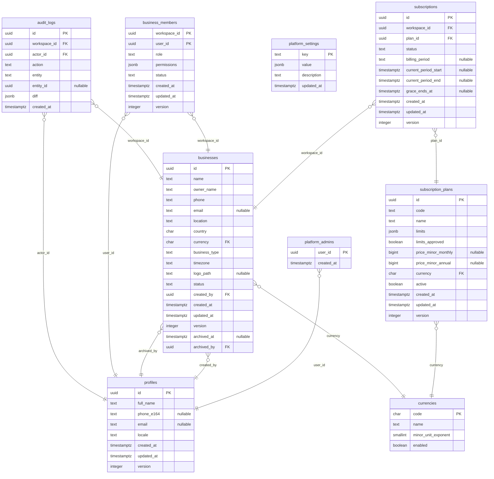

# TailorPro: entity-relationship diagram

> **Generated** by `npm run docs:erd` from the live database. **Do not edit by hand.**
> `tests/integration/erd.test.ts` fails when the schema changes and this file is not regenerated.
> Shows the `public` schema as of the latest migration. Primary key = PK, foreign key = FK.
> Every relationship is drawn as many-to-one (child `}o--||` parent); uniqueness rules such as one active owner per
> workspace and one subscription per workspace are enforced in the database and described in `DATABASE_SCHEMA.md`.

## Links to the authentication system
- `profiles.id` references `auth.users.id` (Supabase Auth, outside the `public` schema).
